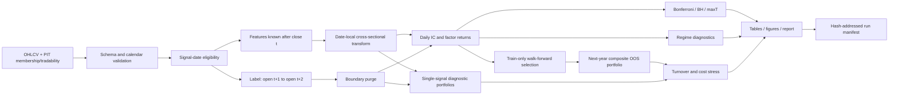

# Robust Alpha Discovery

2026-10-12 新增 V2 动态数据契约与条件反转研究切片。共享实现位于
`data/research_contract.py` 与 `evaluation/conditional_reversal.py`；运行入口在相邻 ML 项目。
见[代码审计](../README.md)、[冻结工程协议](configs/protocols/research_v2.txt)
及[数据接入/CMD 验收](../README.md)。正式 PIT 数据升级仍被阻止，
旧研究入口和历史报告保留。

**直接挖真实 A 股因子的入口已增加**：运行 `run_factor_mining.cmd`，在
`configs/mine_real.yaml` 声明候选与自定义公式，即可计算真实因子、按训练/验证筛选、
冻结候选、评价未来日期并按指定日期导出分数。完整步骤见
[直接挖因子操作说明](README.md)。当前 23 个候选全部未通过筛选，
不会强行生成交易信号；软件可运行与确认盈利 Alpha 分开验收。

一个用于研究横截面股票 Alpha 在数据窥探、样本外衰减、交易成本、多重检验和市场
非平稳性下是否仍然成立的可复现研究框架。

> **当前定位：合格且偏强的量化研究工程作品集，不是已经验证盈利的 A 股策略。**
> 合成数据用于验证研究机制；AKShare 公开数据用于验证真实数据链路；两者都不能作为
> 可交易 Alpha 的证据。正式结论仍需要 point-in-time 股票池、交易状态和公司行动数据。

## 1. 项目要回答什么问题

当研究者同时测试很多看似合理的价量信号时，最好的样本内结果有多少只是偶然？经过以下
约束后，还有多少结果能够保留？

- 严格的 `close(t) → open(t+1) → open(t+2)` 时间对齐；
- 只用训练期信息的年度 Walk-forward 选择；
- 开发集、验证集和最终留出期的独立执行窗口；
- 0/10/20/30 bps 的成本压力测试；
- Bonferroni、Benjamini-Hochberg FDR 和联合 Block-bootstrap maxT；
- 波动、趋势和横截面离散度状态下的稳定性检查；
- 完整的数据、配置、协议、依赖和输出哈希记录。

项目的核心价值不是展示一条漂亮净值，而是展示如何减少“自己骗自己”的概率。

## 2. 它是什么，不是什么

| 能力 | 状态 |
|---|---|
| 可复现的合成数据端到端研究流程 | 已完成 |
| 免费公开 A 股数据接入 smoke | 已完成 |
| Schema、样本日期网格和时序校验 | 已完成 |
| Development/validation/holdout 阶段隔离 | 已完成 |
| Walk-forward 选因及下一年 OOS 复合组合 | 已完成 |
| IC、HAC、组合、成本、多重检验和状态分析 | 已完成 |
| 来源感知的图表、报告和哈希 manifest | 已完成 |
| Point-in-time A 股股票池与历史交易状态 | 未完成 |
| 行业/市值/Beta 中性和基准超额归因 | 未完成 |
| 涨跌停、印花税、冲击、容量和借券模型 | 未完成 |
| 可用于声称 Alpha 的确认性真实数据结果 | **没有** |
| 实盘订单或交易系统 | 不属于当前范围 |

## 3. 当前证据等级

| 运行 | 数据 | 用途 | 能否支持 Alpha 结论 |
|---|---|---|---|
| Fast smoke | 20 个合成资产、320 日、5 个信号 | CI/单元测试和代码路径验证 | 否 |
| Full synthetic demo | 60 个合成资产、900 日、20 个信号 | 完整研究机制验证 | 否 |
| AKShare smoke | 固定 40 股、2018–2020 | 真实数据下载、清洗和计算链路验证 | 否 |
| V1 development | 需要正式 PIT 数据 | 规则开发与冻结 | 尚未运行 |
| V1 validation | 需要冻结规则和正式数据 | 独立验证 | 尚未运行 |
| Final holdout | 配置模板为 2024–2025 | 一次性最终检验 | 未解锁 |

## 4. 研究流程



## 5. 最重要的时间约束

对股票 `i` 和信号日 `t`，特征必须满足：

$$
s_{i,t}=f(\mathcal I_{\leq t})
$$

也就是说，信号只能使用不晚于 `t` 日收盘的信息。标签定义为：

$$
y_{i,t}=\log\left(\frac{O_{i,t+2}}{O_{i,t+1}}\right)
$$

执行序列：

```text
close(t)   : 形成信号和目标权重
open(t+1)  : 假设建仓
open(t+2)  : 假设退出
```

关键防护：

- `t` 日选股只使用当日 `eligible` 和信号，不使用未来的 `target_valid`；
- `entry_date`、`exit_date`、入场和出场交易状态被显式保存；
- 修改未来输入不能改变过去特征，已有回归测试；
- 跨 development/validation/holdout 边界的标签会被 purge；
- Walk-forward 训练年末跨到下一年的标签也会被 purge；
- 每只股票在自身面板生命周期内必须拥有完整市场日期行，不能把复牌日误当作 `t+1`。

当前执行层仍是研究级简化：选中股票若未来收益不可评估，该组合日期会被标记缺失，并在绩效
表中报告 `n_missing_periods`、`return_coverage` 和 `missing_return_rate`，不会静默伪造成零收益。

## 6. 数据契约

真实数据至少需要以下字段：

| 字段 | 含义 |
|---|---|
| `date` | 市场交易日期 |
| `asset` | 稳定证券代码，不能使用会变化的显示名称 |
| `open/high/low/close` | 语义和复权约定明确的价格 |
| `volume` | 成交数量，单位必须记录 |
| `amount` | 成交金额，币种和单位必须记录 |
| `universe_member` | 当时已知的股票池成员状态 |
| `tradable` | 按冻结规则确定的当日可交易状态 |

Schema 会检查：

- `(date, asset)` 唯一；
- `universe_member=true` 的行价格完整、为正且满足 OHLC 不变量；
- `universe_member=true` 的行成交量和成交额完整且非负；
- 布尔字段只能是布尔值或严格的 `0/1/true/false`；
- `tradable=true` 必须同时满足 `universe_member=true`；
- 每只资产的面板日期不能在中间断裂；
- 非成员占位行可保留缺失行情，但不会进入特征、选股或收益计算。

正式研究还应提供：原始成交价、调整后研究价、复权因子、上市/退市日期、历史 ST、停牌、
涨跌停、行业、流通市值、数据供应商时间戳和官方市场日历。

授权数据必须留在被 Git 忽略的 `data/raw/`。不要提交 Wind、CSMAR、聚宽或其他受许可限制
的数据文件。

## 7. 信号库

令日对数收益为：

$$
r_{i,t}=\log C_{i,t}-\log C_{i,t-1}
$$

| 因子族 | 公式或含义 | 已实现名称 |
|---|---|---|
| Momentum | $\log C_t-\log C_{t-h}$ | `mom_5/20/60/120` |
| Skip momentum | $\log C_{t-s}-\log C_{t-h}$ | `mom_20_skip5` |
| Reversal | Momentum 的负值 | `rev_1/3/5` |
| Negative volatility | $-Std(r,w)$ | `neg_vol_10/20/60` |
| Negative range | $-Mean((H-L)/C,w)$ | `neg_range_10/20` |
| Negative Amihud | $-10^8 Mean(|r|/Amount,w)$ | `neg_amihud_20/60` |
| Volume shock | $\log(\overline V_s/\overline V_l)$ | `volshock_5_20` |
| MA gap | $C/MA_w(C)-1$ | `ma_gap_20/60` |
| Risk-adjusted momentum | $Momentum_h/Std(r,w)$ | `mom20_over_vol20`, `mom60_over_vol60` |

方向不会根据观察到的结果事后翻转。`expected_direction` 当前是 registry 元数据；未知方向信号
不会被 pipeline 偷偷改符号。这些方向在正式 V1 前仍需写入冻结协议。

## 8. 横截面预处理

默认使用日期内 Rank Gaussian：

$$
u_{i,t}=\frac{rank(x_{i,t})}{N_t+1},\qquad
z_{i,t}=\Phi^{-1}(u_{i,t})
$$

- 先筛选当日 eligible universe；
- 每个日期独立变换；
- 不使用全样本均值或方差；
- 也支持 `percentile_rank` 和 `zscore`。

## 9. 统计评价

每日 Spearman IC：

$$
IC_t=\rho_{Spearman}(z_{i,t}, y_{i,t})
$$

ICIR：

$$
ICIR=\sqrt{252}\frac{\overline{IC}}{\sigma(IC)}
$$

IC 汇总同时报告 IID 和 Newey-West/HAC 推断。每日横截面因子收益通过下式估计：

$$
y_{i,t}=\alpha_t+\beta_t z_{i,t}+\epsilon_{i,t}
$$

随后对 `beta_t` 时间序列报告均值、朴素 t 统计量以及 HAC 标准误、t 值和双侧 p 值。
这里的 factor return 是单位标准化信号的横截面回归斜率，不等于可直接投资的组合收益。

## 10. Research phase 与最终留出期

带 `time_split` 的配置支持：

| Phase | 统计使用范围 | 是否读取 final holdout |
|---|---|---|
| `development` | 仅开发期 | 否 |
| `validation` | 仅验证期；此前历史只用于滚动特征/训练 | 否 |
| `pre_holdout` | 开发期 + 验证期，明确标记探索性 | 否 |
| `holdout` | 仅最终留出期 | 是，需双重门禁 |
| `auto` | 有 split 时等于 `pre_holdout`；否则为全部配置样本 | 否 |

先复制模板，并在本地副本中填写正式数据路径与协议字段：

```powershell
Copy-Item configs/experiment_v1.yaml configs/local_experiment_v1.yaml
```

然后分别运行阶段：

```powershell
uv run robust-alpha-demo `
  --config configs/local_experiment_v1.yaml `
  --research-phase development

uv run robust-alpha-demo `
  --config configs/local_experiment_v1.yaml `
  --research-phase validation
```

最终留出期必须同时满足：

1. `protocol.status: frozen`；
2. `final_holdout_confirmed_untouched: true`；
3. 显式传入 `--research-phase holdout --include-final-holdout`。

任何一项缺失都会拒绝运行：

```powershell
uv run robust-alpha-demo `
  --config configs/local_experiment_v1.yaml `
  --research-phase holdout `
  --include-final-holdout
```

## 11. Walk-forward OOS

每个测试年执行以下步骤：

1. 只使用之前 `train_years` 个可用日历年的 IC，每个候选因子至少需要 100 个有效日期；
2. purge 掉标签跨年观测；
3. 按训练期平均 IC 选择 top-k；
4. 下一年将已选标准化信号等权平均为 `walk_forward_score`；
5. 构建下一年 long-only 与 long-short 分位数组合；
6. 拼接各测试年的 OOS 日收益、换手和成本结果。

审计产物包括训练选择记录、下一年 IC、复合 OOS 组合日收益与成本后绩效。它解决了“只报告
Walk-forward IC、却把全样本单因子组合叫作 OOS”的常见误导。

## 12. 组合、换手和成本

- Long-only：最高分位等权，总权重为 1；
- Long-short：最高分位总权重 +1，最低分位总权重 -1，总名义敞口为 2；
- 分位数由 `evaluation.quantile` 冻结；
- 每日可用股票数至少达到 `evaluation.min_assets_per_date` 才建立组合；
- 单因子组合是诊断结果；Walk-forward 复合组合才是选择感知的 OOS 诊断。

单边换手定义为：

$$
TO_t=\frac12\sum_i|w_{i,t}-\widetilde w_{i,t-1}|
$$

其中 $\widetilde w$ 是上一期收益漂移并按多空腿重新缩放后的权重。线性成本为：

$$
R^{net}_t=R^{gross}_t-TO_t\frac{bps}{10,000}
$$

绩效输出包括：

- 年化算术平均收益 `annualized_return`；
- CAGR；
- 年化波动、Sharpe、Sortino；
- 最大回撤、Calmar、胜率和累计收益；
- 有效期数、缺失期数和收益覆盖率。

Sharpe 当前未扣无风险利率。A 股个股 long-short 应被视为研究诊断，不代表能够低成本借券执行。

## 13. 多重检验

项目并列展示四种判断：

- Naive：未校正双侧 p 值；
- Bonferroni：控制 family-wise error rate；
- Benjamini-Hochberg：控制 false discovery rate；
- Joint moving-block maxT：所有信号按相同日期块联合抽样，保留时间簇和因子间依赖。

MaxT 在全局零假设下先将每日因子收益去均值，再比较最大绝对 t 统计量。Monte Carlo p 值
的最小分辨率约为 `1 / (B + 1)`；因此 AKShare smoke 的 100 次和快速测试的 20 次仅用于验证
代码路径，不适合精细推断。

## 14. 市场状态

- Volatility：等权市场收益的 20 日波动，相对历史扩展中位数；
- Trend：累计等权基准相对 120 日均线；
- Dispersion：当日横截面收益标准差，相对历史扩展中位数。

阈值使用 `shift(1)`，不会利用未来状态。状态结果目前是探索性异质性描述，不是独立的确认性
假设检验。

## 15. 安装与质量检查

要求 Python `>=3.11`，推荐使用 `uv`：

```powershell
uv sync --dev
uv run ruff check .
uv run pytest -q
```

`uv.lock` 已提交；`.venv/`、原始数据、处理数据和生成报告均不会提交。

如果依赖已存在但项目尚未安装：

```powershell
$env:PYTHONPATH = (Resolve-Path "src").Path
python -m pytest -q
python -m robust_alpha.pipeline --config configs/base.yaml
```

## 16. 合成数据快速开始

快速 smoke：

```powershell
uv run robust-alpha-demo --config configs/test_smoke.yaml
```

完整演示：

```powershell
uv run robust-alpha-demo --config configs/base.yaml
```

| 配置 | 规模 | 信号数 | Bootstrap 次数 |
|---|---:|---:|---:|
| `configs/test_smoke.yaml` | 20 资产 × 320 日 | 5 | 20 |
| `configs/base.yaml` | 60 资产 × 900 日 | 20 | 300 |

## 17. AKShare 真实数据 integration smoke

AKShare 是当前唯一安装的数据接口；曾评估 BaoStock，但其服务端点在当前网络无法连接，已经从
项目、锁文件和虚拟环境中完全删除。

下载固定 40 股、2018–2020 日线：

```powershell
uv run robust-alpha-fetch-akshare `
  --config configs/akshare_smoke.yaml `
  --bypass-proxy
```

运行完整的来源感知报告：

```powershell
uv run robust-alpha-demo --config configs/akshare_smoke.yaml
```

本地 smoke 数据的确定性结构为 40 只股票、730 个市场日期和 29,200 行完整网格。精确质量
统计请查看每次运行生成的 `tables/data_quality.csv`，而不要复制某一次运行的临时数字。

此运行存在以下限制：

- 股票由人工固定选择，存在选择偏差和幸存者偏差；
- `universe_member` 不是真实历史指数成分；
- 缺少可靠的历史 ST、涨跌停和官方停牌原因；
- 当前 `qfq` OHLC 同时用于信号和开盘标签，不应解释为真实可成交价格；
- 交易日历来自样本报价日期的并集，而不是交易所官方日历；
- AKShare 包装第三方公开接口，没有机构级数据 SLA。

因此该结果只能证明数据接入、清洗、对齐和计算链路可运行。

## 18. 输出文件

默认输出位于配置的 `output.directory`。命名 research phase 会写入对应子目录，防止不同阶段
相互覆盖。

| 产物 | 含义 |
|---|---|
| `tables/data_quality.csv` | 覆盖、成员、可交易性和缺失质量摘要 |
| `tables/daily_ic.csv` | 当前 evaluation window 的每日 Spearman IC |
| `tables/ic_summary.csv` | IC、ICIR、命中率、IID 与 HAC 推断 |
| `tables/daily_factor_returns.csv` | 每日横截面回归斜率 |
| `tables/factor_return_summary.csv` | 朴素和 HAC 因子收益推断 |
| `tables/walk_forward_selections.csv` | 每个测试年的训练期 top-k 选择轨迹 |
| `tables/walk_forward_combinations.csv` | 所选单因子下一年每日 IC 的跨信号均值汇总；不是复合分数 IC |
| `tables/walk_forward_portfolio_daily.csv` | 跨年份拼接的选因 OOS 组合、换手和成本 |
| `tables/walk_forward_portfolio_performance.csv` | 选择感知的 OOS 绩效摘要 |
| `tables/multiple_testing.csv` | Naive、Bonferroni、BH 和 maxT 结果 |
| `tables/bootstrap_max_statistics.csv` | 联合零假设最大统计量分布 |
| `tables/regime_dates.csv` | 每日市场状态和构造字段 |
| `tables/regime_ic_summary.csv` | 各状态下的 IC 摘要 |
| `tables/portfolio_daily.csv` | 单因子诊断组合日收益、换手和成本 |
| `tables/portfolio_performance.csv` | 单因子诊断绩效；不能事后挑最高者称为 OOS |
| `figures/*.png` | 最多六张诊断图；部分图依赖足够的年份和有效结果 |
| `validation_report.md` | 数据源和 phase 感知的 Markdown 报告 |
| `run_manifest.json` | 配置、输入、协议、lockfile 和产物 SHA256 等审计信息 |

Manifest 还记录运行时间、Python/关键包版本、Git commit/dirty 状态、样本覆盖、随机种子和结果
证据范围。

## 19. 项目结构

```text
configs/                 可复现实验定义
data/
  README.md              数据字段、许可和目录约定
  raw/                   私有/下载数据，Git ignored
  processed/             生成研究面板，Git ignored
reports/generated/       实施与验收证据、科学报告
reports/generated/       生成表格、图和报告，Git ignored
scripts/                 00 数据下载 + 01–05 可检查阶段脚本
src/robust_alpha/
  data/                  加载、Schema、质量、对齐、AKShare 适配
  features/              20 个预定义价量信号
  preprocessing/         日期内横截面变换
  evaluation/            IC、因子收益和绩效指标
  portfolio/             权重、收益、换手和成本
  validation/            Phase、Walk-forward、Bootstrap、状态和 p 值校正
tests/                   单元、前视防护、适配器和端到端 smoke
configs/protocols/       冻结研究契约及 holdout 门禁
pyproject.toml           包、CLI、依赖和工具配置
uv.lock                  锁定依赖图
```

## 20. 自动化防护覆盖

测试不只验证“代码能跑”，还覆盖：

- Schema、重复键、严格布尔值和 OHLC 不变量；
- 稀疏资产日历拒绝；
- `t+1/t+2` 开盘标签和交易状态；
- 修改未来输入不改变过去特征；
- 当日横截面变换和 universe 过滤；
- 已知答案的 IC 与横截面回归；
- 未来交易状态不能改变 `t` 日目标权重；
- Walk-forward 只用训练期且正确生成下一年复合信号；
- 研究 phase 和 holdout 双重门禁；
- 换手、成本、多重校正和联合 Bootstrap 可复现性；
- AKShare 字段归一化、缺报日网格和交易所拒绝规则；
- 完整合成 pipeline smoke。

## 21. 已知限制

在正式展示或简历中必须保留这些边界：

1. AKShare 样本不是 point-in-time 股票池，不能支持实证 Alpha 结论；
2. 没有完整退市股、IPO 历史、ST、涨跌停和官方停牌状态；
3. 调整后研究价格与真实执行价格尚未分离；
4. 执行模型没有状态化处理拒单、延迟退出和停牌持仓延续；
5. 线性成本未覆盖卖侧印花税、最低佣金、滑点、冲击和容量；
6. Long-short 未建模融券可得性和借券费；
7. Long-only 尚未对 CSI 300/中证 800 等基准计算超额收益；
8. 尚未做行业、市值、Beta 和风格中性化或风险归因；
9. 多重检验的候选家庭目前以配置中的因子回归为主，未覆盖所有研究者自由度；
10. HAC lag、Bootstrap block、分位数和成本假设仍需预先冻结并做敏感性分析；
11. 状态分析是描述性的，不是独立确认性检验；
12. `expected_direction` 尚未成为机器执行的单侧假设约束；
13. 正式 V1 协议仍为 `DRAFT`，最终 holdout 尚未运行。

## 22. 正式研究还需要什么

要把本项目从“可信研究框架”升级为“可信 A 股实证研究”，至少需要：

1. 确定股票池和历史成分来源；
2. 获取未复权执行价、点时复权因子和公司行动；
3. 获取历史 ST、停牌、涨跌停、上市和退市状态；
4. 冻结 IPO seasoning、缺失开盘、价格限制和退市收益规则；
5. 加入基准收益、行业/市值/Beta 中性和容量约束；
6. 冻结成本、HAC lag、Bootstrap block 和候选假设家庭；
7. 只用 development 开发，随后独立运行 validation；
8. 将协议状态改为 `FROZEN V1` 后，最终 holdout 只运行一次。

推荐的数据路线是 Tushare Pro 作为个人研究起点，Wind/CSMAR 等授权数据用于正式交叉验证。

## 23. 推荐的项目表述

适合写在简历或面试中的表述：

> 构建了一个可复现的横截面 Alpha 研究框架，包含严格时序对齐、训练期选因、年度 OOS
> 复合组合、交易成本、多重检验、市场状态分析、研究阶段隔离和哈希化实验审计；合成与
> 公开数据运行用于验证研究机制和数据链路，尚未声称发现可交易 Alpha。

不要写：

- “发现了显著 A 股 Alpha”；
- “AKShare 回测证明策略有效”；
- “可以直接实盘”；
- “当前结果无幸存者偏差”；
- “已完成预注册和最终样本外检验”。

## 24. 编号阶段

端到端 CLI 是推荐入口；也可以逐阶段检查：

```powershell
uv run python scripts/01_build_panel.py --config configs/base.yaml
uv run python scripts/02_compute_features.py --config configs/base.yaml
uv run python scripts/03_run_signal_screen.py --config configs/base.yaml
uv run python scripts/04_run_oos.py --config configs/base.yaml
uv run python scripts/05_build_report.py --config configs/base.yaml
```

每个阶段都会从同一份 YAML 重新生成上游输入，确保可复现。正式 phase 研究建议使用
`robust-alpha-demo --research-phase ...`，因为主 CLI 暴露了完整的阶段隔离和 holdout 门禁参数。

更细的数据语义见 [`data/README.md`](README.md)，当前实现状态见
本 README，冻结前决策见
[研究契约](configs/protocols/factor_mining_v1.txt)。


## 统一历史数据采集与 V3 接入

本项目拥有公共采集器：`data/history_api.py` 隔离接口调用，`history_store.py` 负责原始存档与恢复，`historical.py` 复用 V3 规范化与审计。公共 bundle 为 `data/historical_v3/range`；完整来源、证据边界、数量、字段缺失和运行顺序见[总 README](../README.md)。不要调用旧 `complete_market_date_grid` 构造新历史数据，它会沿用停牌价格。

```bat
uv run robust-alpha-history all --config configs\historical_data.yaml
uv run robust-alpha-history crosscheck
uv run robust-alpha-history verify --bundle data\historical_v3\range
```

阶段可以单独运行 `probe/sample/year/range/bulk`。重复执行复用 SHA 校验通过的成功响应，失败会重试，原始版本保留。`range/acceptance.json` 给出实际下载数、退市/停牌、缺失率和未解决问题；`v3_pit_audit.json` 是正式门禁结果。未经认证的历史可用时间保持空值，不能通过估计 EOD 时间开放正式研究。

直接挖因子沿用 `run_factor_mining.cmd` 或 `uv run python scripts\mine_factors.py mine --config configs\mine_real.yaml` 后 `evaluate`。候选公式在 `custom_factors` 配置；先冻结训练/验证选择和 trials，再评价独立数据，拒绝候选仍保留。原 40 股 qfq 缓存仅供旧探索实验复现，不与新未复权 canonical 数据混合。导入自有真实 CSV 时须保持供应商代码、单位和版本证据，补齐官方日历及真实历史可用时点后才能注册正式协议。
