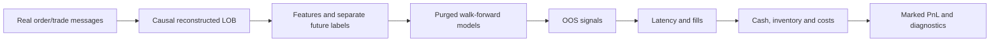
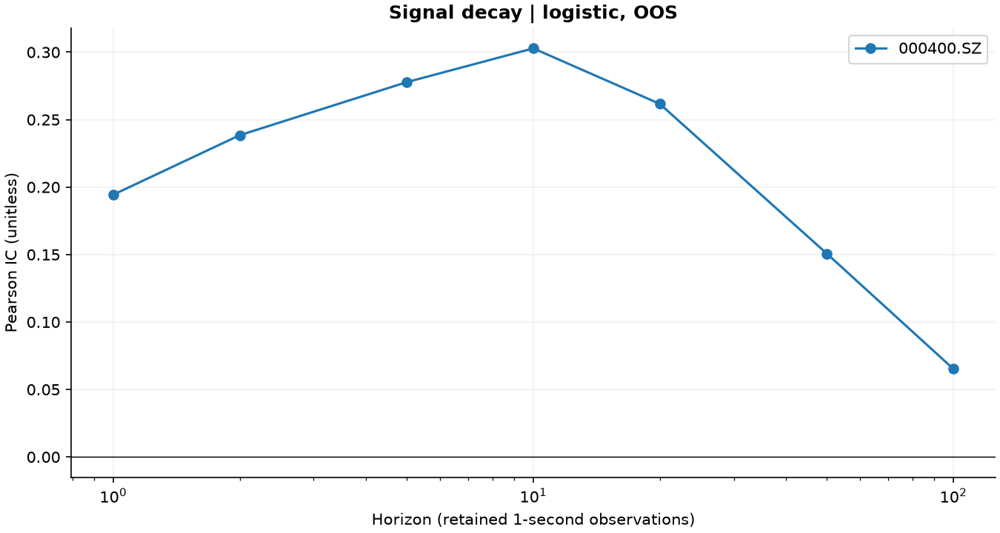
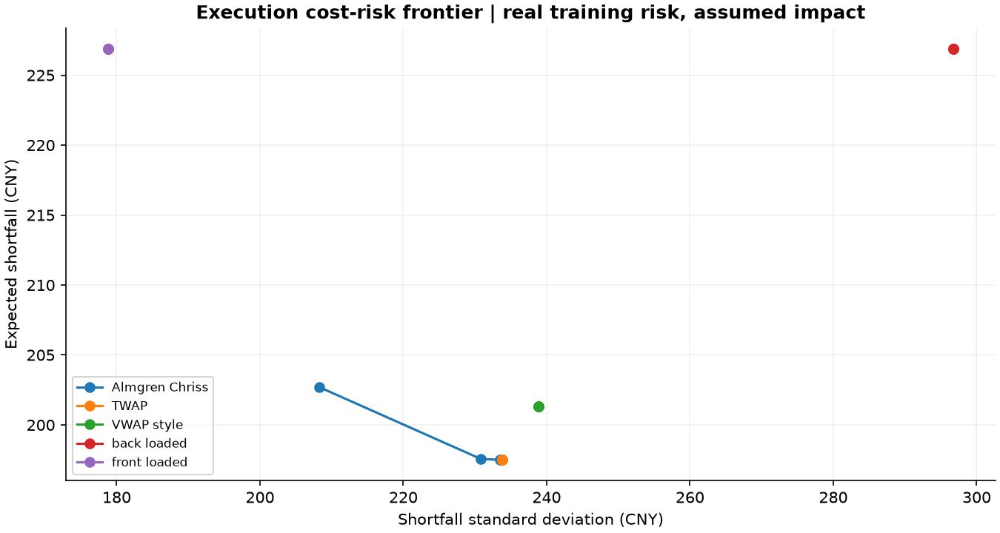
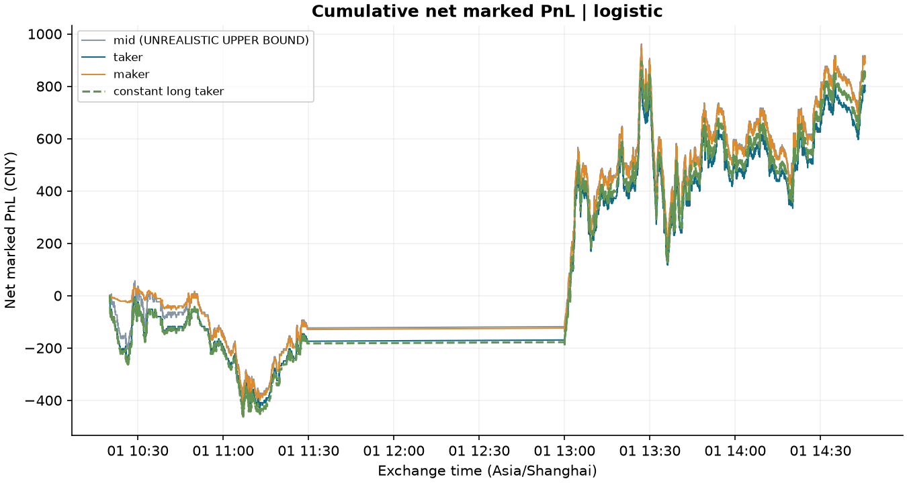

# Market Microstructure & Execution

**Limit Order Book Signals, Short-Horizon Prediction, Transaction Costs and Optimal Execution**

Python 3.12 / uv research using **real historical A-share messages**: **000400.SZ, 2022-06-01**, reconstructed into a five-level book. Synthetic data support engineering tests and are isolated from empirical results.

**快速查看：**[完整研究报告及 33 张图](outputs/research_report.html)、[Markdown 报告](outputs/research_report.md)、[阶段记录](README.md)、[产物核对](outputs/tables/verification_summary.json)。本机已有原始数据、运行结果和四本 notebook，主流程无需数据账号。

The central finding is a distinction: this stock-day has OOS predictive information, but an empty cash-stock account cannot complete same-day buy/sell round trips under T+1. Positive marked PnL primarily reflects held-stock appreciation. The logistic taker also trails a constant-long benchmark. This is not evidence of a deployable high-frequency strategy.

## Motivation

Prediction and execution profitability answer different questions. The framework follows a signal through quotes, latency, fills, inventory, costs and a reconciled cash ledger. Unavailable statistics and failed sources are recorded explicitly. Its purpose is a reviewable Quantitative Researcher portfolio.



## Research Questions

Does imbalance predict future mid movement? Do spread, depth and microprice add information? Which features are stable? Can prediction survive costs? How do maker fills, adverse selection, volatility/liquidity regimes, signal decay and latency alter the outcome? Can optimal execution improve the cost-risk trade-off?

The [report](outputs/research_report.md) answers all ten requested questions and states the limits of each inference.

## Market Microstructure Background

For best bid $b$, ask $a$ and displayed sizes $V_b,V_a$:

$$m=(a+b)/2,\quad s=a-b,\quad s_{bps}=10^4s/m,\quad I_1=(V_b-V_a)/(V_b+V_a).$$

Mid is a reference value. An immediate buyer pays ask and seller receives bid; crossing a round trip consumes spread before fees or adverse movement. K-level imbalance uses weighted bid/ask size sums. Equal weighting and distance decay are supported, with weights $1/(1+\text{distance from best}/s)$ separately on each side. Zero total depth gives neutral imbalance.

$$\text{microprice}=\frac{V_a b+V_b a}{V_a+V_b},\qquad
\text{deviation}=\text{microprice}-m.$$

Larger bid size shifts microprice toward ask. It is a quote estimator, not an executable price or a calibrated efficient-price oracle. With zero depth it defaults to mid. Five-level depth is the sum of displayed quantities on both sides.

Primary motivation: [Gould and Bonart on imbalance](https://arxiv.org/abs/1512.03492), [Cont, Kukanov and Stoikov on order flow](https://arxiv.org/abs/1011.6402). Their empirical findings are not assumed to hold for this dataset.

## Data

| Item | Primary experiment |
| --- | --- |
| Security / date | 000400.SZ / 2022-06-01 |
| Source | Public SZSE order/transaction messages |
| Pinned commit | `12c60567d4a20aece2dd6e27f63e30339ec233e7` |
| Replay scope | 222,651 messages for the predeclared main-board stock |
| Accepted snapshots | 14,179, five levels, one-second grid |
| Crossed states excluded | 41, or 0.2883% of 14,220 continuous-session endpoints |
| Missing order references / over-reductions | 0 recorded |
| OOS rows | 10,500/model, 10,490 labeled at the main horizon |
| OOS coverage | 10:20:08–14:45:38 Asia/Shanghai; complete test windows |
| Independent official snapshot reconciliation | Unavailable |

The [published sample](https://github.com/Agnes252/LOB-Reconstruction/tree/12c60567d4a20aece2dd6e27f63e30339ec233e7/data_test) is fetched with Python Requests and parsed with pandas. [Pinned configuration](configs/public_sample.yaml) and [manifest](outputs/tables/public_sample_manifest.json) record SHA-256. Raw CSVs remain local and are Git-ignored; unrestricted redistribution rights are not assumed.

Five securities exist in the source. The ordinary Shenzhen main-board stock was selected to establish account-rule scope, not through model performance. Excluded securities are counted. Shared-channel sequence gaps can represent other securities rather than missing target messages.

Reconstruction maintains order IDs, integer-cent price levels and remaining sizes. Transactions/cancellations reduce referenced orders; anomalies are audited, not filled with invented liquidity. Price-zero market orders are tracked without creating displayed limit depth. Own-best orders use the arrival-time best quote. The actual sample uses `TradeType=0` for trades and `1` for cancellations; the adapter checks that encoding despite inconsistent upstream prose. No upstream reconstruction code runs.

Each endpoint consumes only received messages at or before it, in application sequence. Reception-clock repairs are audited (zero here). Continuous sessions are 09:30–11:30 and 13:00–14:57; auctions/crossed books are counted separately. Session identity preserves lunch boundaries. Zero missing references establishes internal consistency, not certified book accuracy.

Python library adapters were also implemented and probed. [AKShare](https://akshare.akfamily.xyz/data/stock/stock.html) current bid/ask requests failed in this environment and were recorded. [Easyquotation](https://github.com/shidenggui/easyquotation) read Sina five-level snapshots for four A shares over bounded HTTPS; volumes are already shares and are not multiplied by 100 again. Those quotes were stale during the [2026 National Day closure](https://www.sse.com.cn/disclosure/announcement/general/c/c_20260915_10832273.shtml) and were not substituted for historical data. See the [probe audit](outputs/tables/ashare_source_probe.json). Free current snapshots are not a certified historical L2 tape.

The vendor-neutral schema is `timestamp`, `asset`, complete `bid_price_1..K`, `bid_size_1..K`, `ask_price_1..K`, `ask_size_1..K`, K≤5. Trade price/size/side and signed interval flow are optional. Storage is UTC; source China-local times are converted explicitly. Keys must be unique and chronological. Prices must be finite/positive, sizes finite/nonnegative and bids below asks. Validation fails by default; optional bounded deletion emits reasons, counts and fractions.

## Feature Engineering

Thirteen causal predictors cover L1/K imbalance, spread bps, microprice deviation bps, log depth, lagged return, trailing realized volatility, spread/depth/imbalance changes, rolling best-quote OFI, trade intensity and signed volume imbalance.

Windows look backward and reset by asset/session. Warm-up NaNs are visible; imputation uses training medians only. Intensity is the fraction of intervals with trades, not an invented exact arrival rate. Signed flow comes from messages; a price-only fallback tick rule uses previous prices. Quote-only resampling removes trade-flow fields to avoid duplicating transactions. No future/centered fills, global scaling, label columns or synthetic truth fields enter the whitelist.

Fixed logistic ablations compare imbalance only, imbalance/spread/depth and all features on identical folds; OOS scores do not select features.

## Prediction Targets

Regression predicts future **mid** return $10^4(m_{t+\Delta}/m_t-1)$ in bps. Classification is +1 above +0.5 bps, −1 below −0.5 bps and 0 inside the neutral band. Binary mode explicitly excludes neutral labels. Event/time horizons are configurable and mutually exclusive. Elapsed-time labels choose the first observation at or after the delay; unavailable tails remain NaN.

The primary horizon is **10 retained one-second observations**, approximately ten seconds, not ten raw exchange messages. Labels do not cross lunch/session boundaries.

## Signal Models

Linear regression estimates returns. L2 logistic and Random Forest estimate three-class probabilities; directional score is $p_{up}-p_{down}$. Linear score is $\tanh(\hat y/2\text{ bps})$. Training-only median imputation/scaling, seeds and hyperparameters are configured; no neural-network dependency is required.

Importance uses training OLS/HAC coefficients per asset and validation forest permutation scores. Fold variation is reported. Correlated imbalance/spread/microprice variables can make coefficients and rankings unstable; neither establishes causality.

## Time-Series Validation

Fourteen expanding folds use 2,500 initial clock observations, 500 validation, 750 test, a 750 step and ten-observation embargo. Label-end purging removes immature overlapping targets at each boundary. The [fold audit](outputs/tables/fold_audit.csv) records actual retained counts and latest label times. Rolling windows are supported.

Each OOS key appears once/model. The final partial test window is excluded and the cutoff disclosed. No random split/K-fold is used. Saved final-fold models are inspection artifacts and must not backfill earlier OOS predictions.

Labels remain dependent despite purging. HAC and contiguous timestamp-block bootstrap address some within-day dependence, not between-day uncertainty. OOS quantile bins are descriptive and never feed back into strategy thresholds.

## Execution Models

1. **Mid: UNREALISTIC UPPER BOUND.** Cost-free comparator, never executable performance; differing fill paths prevent a universal numerical bound across maker results.
2. **Taker:** buy ask/sell bid, capacity limited to 10% of opposite L1 depth, with adverse slippage and temporary impact.
3. **Maker: simplified fill model.** Fixed-price limits rest after latency; no placement-observation fill. Later opposing flow at an eligible price or quote-through permits probabilistic capacity-limited fills. Queue ahead is a static arrival-depth proxy, not exact exchange FIFO.

Maker probability is a configured sigmoid of intensity/flow, signed imbalance and queue pressure, using a seeded local RNG. TTL/cancellation are explicit. A new signal cannot cancel trades already occurring in the preceding interval. Cancellation latency and within-second hypothetical own-order ordering remain simplified. Future markouts do not affect fills.

An ordinary Shenzhen cash-stock account starts empty: no naked shorts/negative cash, 100-share buy submissions, integer partial fills and T+1 settled-stock sales. Negative signals request flat inventory without bypassing settlement. Final-quote liquidation attempts leave blocked stock in the ledger. [Sample-period trading rules](https://docs.static.szse.cn/www/lawrules/rule/trade/W020210331716400647184.pdf).

Generic shorting/rebates support engineering tests and are not primary A-share assumptions.

## Transaction Costs

The historical configuration assumes 3 bps broker commission, CNY 5/order minimum, 10 bps sell stamp tax and 0.1 bps bilateral transfer fee. Commission is a broker assumption; maker partials accrue against cumulative order notional rather than paying the minimum repeatedly. The separate live config uses 5 bps stamp tax after the [official 2023 reduction](https://fgk.chinatax.gov.cn/zcfgk/c102416/c5211343/content.html). [Broker implementation of the 2022 transfer-fee change](https://www.xcsc.com/main/a/20220429/1022871784.shtml).

Adverse slippage/share is $p(c_1+c_2q/D)/10^4$; temporary impact/share is $p c_I(q/D)^\alpha/10^4$, with $\alpha=1/2$. Buy/sell signs move execution adversely. Signed spread cost is $q(p_{quote}-m)$; maker capture can make it negative. Parameters are YAML-controlled.

The replay charges **temporary impact only**, without changing future historical prices/depth. Permanent impact is in the separate AC model. Neither impact coefficient is calibrated from own-order response.

## Event-Driven Backtest

The loop marks prior inventory, processes past-interval resting fills, processes older decision arrivals, creates current targets and handles zero-latency arrivals. Orders, FIFO lots, IDs and RNG are run-local. Latency is asset-local, not pooled row count. Cash-stock targets are +1,000 shares above +0.20 and flat otherwise, with 100-share child submissions; capacity/odd-lot partials can prevent reaching target.

$$\text{Net marked PnL}=\text{realized gross alpha}+\text{gross inventory MTM}
-\text{spread}-\text{fees}-\text{slippage}-\text{impact}.$$

This reconciles against cash + marked positions − initial capital at every event. Open MTM is not added twice. Closed FIFO lots allocate entry/exit fees. Here no lots close, so hit rate/completed holding time are **unavailable**. Fill count is not round-trip count. Sharpe uses fixed one-second equity changes and is **unannualized**. INFO logs summarize; DEBUG files record orders, prices, costs, inventory and PnL.

## Signal Decay

OOS horizon IC uses 1/2/5/10/20/50/100 retained observations. Peak |IC| is at ten; the first sampled later horizon reaching half is 50. This threshold-crossing half-life is descriptive, not an exponential fit or a precise 50-second estimate.



## Maker vs Taker

Maker limits may capture spread but face nonfill and unfavorable fills. Signed post-fill mid markout is $\operatorname{sign}(q)(m_{t+\Delta}-m_t)/m_t$ in bps; negative is adverse for either side. Spread capture, markout and portfolio PnL are separated. Ten simplified logistic-maker fills cannot validate fill calibration; inventory differences can explain ranking.

## Latency Analysis

Saved OOS signals are replayed with 0/1/5/10 observation delays. This input supports coarse second-scale sensitivity, not submillisecond routing inference. Entry price, capacity and locked inventory can vary non-monotonically; no declining PnL curve is imposed.

## Regime Analysis

Initial training medians define low/high volatility, tight/wide spread and low/high liquidity. Tables compare IC, prediction metrics, incremental PnL, spread and maker fill rates. Each pair partitions events, but dimensions overlap and must not be summed. Maker fill rates follow arrival cohorts. Rolling IC/PnL, coefficients and importance expose within-day instability, not cross-day robustness.

## Optimal Execution

The independent mandate liquidates **already-settled** 10,000 shares over 20 seconds/20 intervals. Sigma and half-spread use initial real training history. VWAP-style uses a historical clock-phase flow forecast, not future realized volume. Eta/gamma are uncalibrated sensitivity inputs.

For $x_0=X,x_N=0$, $n_k=x_{k-1}-x_k$, $\tau=T/N$, execution precedes interval innovation/permanent impact:

$$\tilde S_k=S_{k-1}-\epsilon-\eta n_k/\tau,\quad
S_k=S_{k-1}+\sigma\sqrt\tau\xi_k-\gamma n_k.$$

$$E[C]=\epsilon X+\gamma X^2/2+(\eta/\tau-\gamma/2)\sum n_k^2,\quad
\operatorname{Var}(C)=\sigma^2\tau\sum x_k^2.$$

A tridiagonal solver minimizes $E[C]+\lambda\operatorname{Var}(C)$ with $\eta/\tau>\gamma/2$. Zero risk aversion gives TWAP; greater aversion front-loads, lowering variance at increased expected cost. AC, TWAP, VWAP-style and front/back schedules form **160 parameter cases**. Conservation, gradient optimality and independent price-path moments are tested.

Continuous schedules and conserving 100-share largest-remainder rounds have separate costs. Rounding is not an integer optimizer; no calibrated observed execution-quality claim is made. [Original AC paper](https://doi.org/10.21314/JOR.2001.041).



## Robustness Tests

Fourteen predeclared cases retain baseline; latency 0/1/5/10; spread 1/1.5/2; commission 1/2; depth 1/0.5; signal noise; and 2× path volatility. Fixed OOS signals are changed only in the explicit noise case; no stressed test-label refit occurs. Duplicate 1× cases confirm baseline consistency.

These are conditional execution sensitivities. Scaling a realized path also scales its direction; increased PnL under that shock is not new-regime robustness. Mathematical spread stresses can leave the tick grid. T+1 can make signal perturbations inactive once stock is locked.

## Results

Fourteen folds produce 31,500 OOS rows and 84 validation/test evaluations. Full logistic IC is 0.303 versus imbalance-only 0.159; macro OvR AUC is 0.700. These are overlapping-label, within-day results.

| Model | Three-class accuracy | OOS IC | Taker net marked PnL (CNY) | Remaining shares |
| --- | ---: | ---: | ---: | ---: |
| Linear | unavailable: regression | 0.255 | 842.28 | 990 |
| Logistic | 52.66% | 0.303 | 803.41 | 940 |
| Random Forest | 51.94% | 0.260 | 889.63 | 950 |
| Constant long | unavailable: no prediction | unavailable | 857.29 | 1,000 |

The best IC does not give the best taker PnL. Logistic gross marked alpha is CNY 861.00, minus spread 6.90, fees 50.19, slippage 0.24 and impact 0.27. Net 803.41 is **held-stock appreciation after costs**, not realized intraday profit; zero lots close. Three-class accuracy is not a trade win rate.

Capacity/lot constraints leave 940 logistic shares versus 1,000 benchmark shares and different invested notionals. Raw PnL differences are not exposure-normalized excess returns and cannot independently establish alpha or signal underperformance.



All model/mode comparisons and predeclared scenarios remain in [the report](outputs/research_report.html). Required tables: `signal_summary.csv`, `model_summary.csv`, `execution_summary.csv`, `pnl_decomposition.csv`, `robustness_summary.csv`, `optimal_execution_summary.csv`. Extra aggregates/ablations, source/fold audits and input/version hashes enable review.

## Limitations

One reconstructed stock-day cannot establish a durable edge or cross-stock stability. Official book reconciliation is absent. Reception delay, invalid states and one-second aggregation limit finer inferences. No initial settled stock or next-day tape exists to realize the residual position.

Queue/fill probabilities, cancellation timing, slippage and impact are uncalibrated. Auctions, corporate actions, daily price bands, suspensions, ST-specific rules, calendars and broker routing are not implemented as an exchange emulator. Valid historical quotes constrain this experiment but do not replace these mechanisms for future data. No broker is connected and no live order was placed.

## Repository Structure

```text
configs/                  research/account assumptions and pinned source
data/raw,interim,processed real messages, reconstruction, features and OOS rows
src/market_microstructure/
  data/                   adapters, replay, schema, sampling, test generator
  features/ labels/       causal predictors and separate future targets
  models/                 estimators, purged splits, metrics and ablations
  execution/ costs/       latency, fills, A-share rules, fees and impact
  backtest/ strategies/   event engine, FIFO cash ledger and targets
  diagnostics/            decay, regimes, markouts, stresses
  optimal_execution/      AC, schedules, rounding and experiment grid
  reporting/ utils/       plots, report, paths, config and logging
scripts/ tests/ notebooks/ small CLI entry points, invariants, four notebooks
outputs/                 figures, tables, ledgers, logs and scientific reports
```

Related formulas share cohesive tested modules rather than one thin file per formula. Stateful replay/accounting uses explicit iteration; features/labels are vectorized and AC uses a banded solve. Numba is available without unjustified acceleration of this sample.

## Reproduction

**Windows CMD**, from the project directory. The local workspace already includes cached real source data; the core workflow needs no data account/fresh fetch.

```cmd
cd /d C:\Users\19388\Desktop\项目\market_microstructure_execution
uv sync
uv run pytest
uv run python scripts\prepare_data.py
uv run python scripts\build_features.py
uv run python scripts\train_signal.py
uv run python scripts\run_backtest.py
uv run python scripts\generate_report.py
uv run python scripts\verify_artifacts.py
uv run python scripts\verify_notebooks.py
uv run python scripts\verify_artifacts.py --require-notebooks
```

`uv.lock` fixes versions and `.uv-cache` stays local. YAML paths resolve against the project. `generate_report.py` runs AC and fixed ablations too. AC alone:

```cmd
uv run python scripts\run_optimal_execution.py
```

A fresh checkout without raw cache first fetches the fixed source and reconstructs:

```cmd
uv run python scripts\probe_ashare_sources.py --historical-sample
uv run python scripts\reconstruct_public_sample.py
```

Download needs network but no login/token. SHA-256 must match; mismatched existing files are not overwritten and failures never substitute synthetic prices. Workers have hard timeouts. `--bypass-proxy` is an explicit optional local-connection setting.

Recreate/reexecute notebook sources:

```cmd
uv run python scripts\create_notebooks.py
uv run python scripts\verify_notebooks.py
```

Synthetic fixtures test known-beta recovery, causality and accounting. Optional `configs/synthetic_validation.yaml` routes research outputs into `outputs/engineering_validation/latest/`, with separate inputs/features/predictions. Earlier smoke outputs are archived. The empirical report rejects a synthetic source.

## Future Work

Obtain licensed multi-day/multi-stock L2 and official reference snapshots; calibrate fills with own-order data; run an untouched later holdout. Add settled inventory/multi-day liquidation to separate timing from directional exposure. Extend exchange rules, cancellation latency, impact misspecification and integer optimization.

See [interview guide](README.md) and [assumptions/references](README.md).


## 研究证据与适用边界

本次公共历史日线数据工程仅服务三个中低频项目；本项目执行代码和真实逐笔产物保留。订单簿研究须明确同一父订单、截止时间、已结算库存和风险预算；queue/fill/冲击模型依赖实际事件证据。单股票日不能推断跨市场盈利。引用、事件账与验证证据保留在既有 `outputs` 科学报告中，统一项目入口见[总 README](../README.md)。
