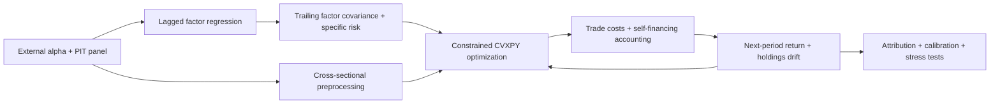
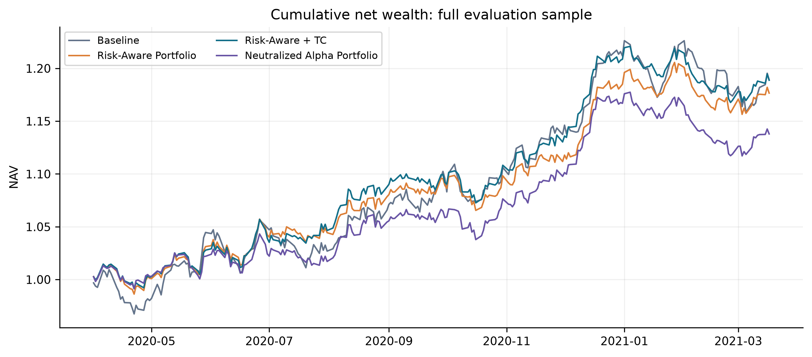
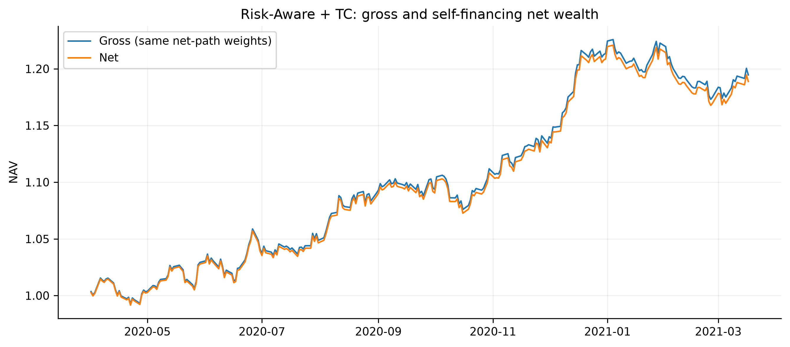
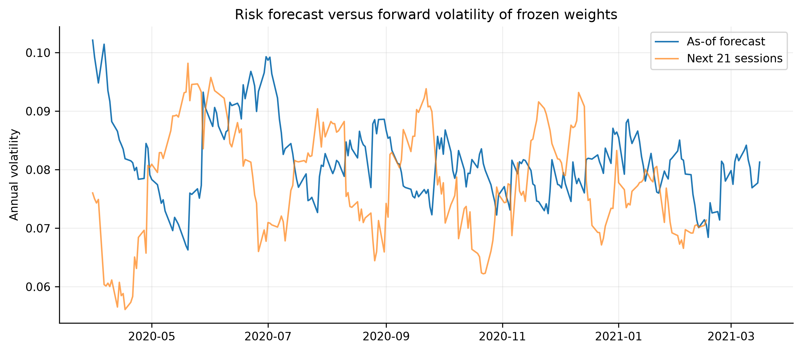
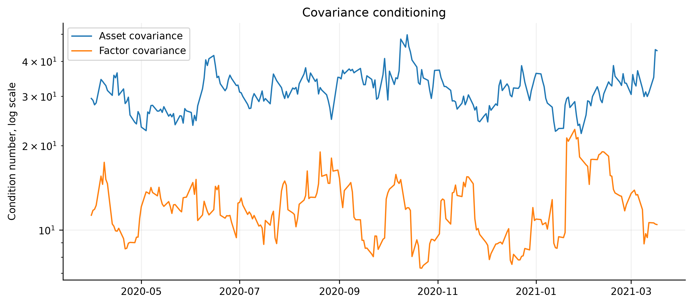
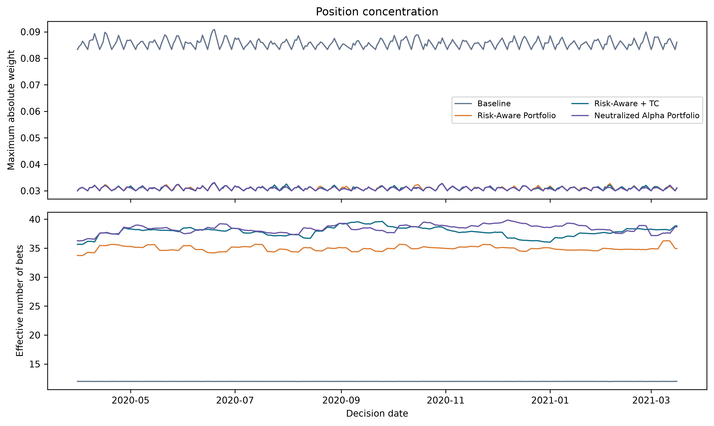
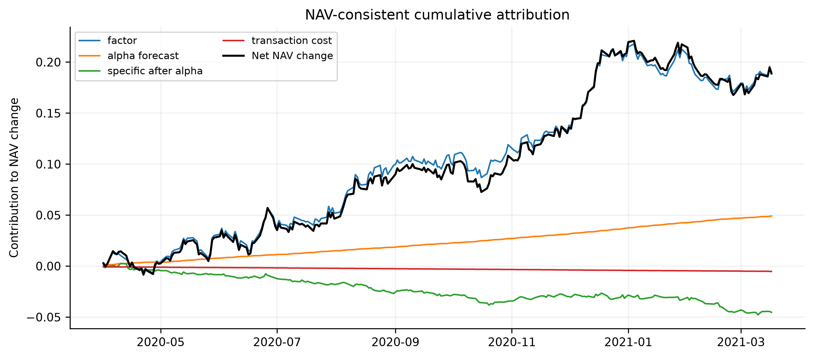

# Risk-Aware Portfolio Construction

V2 update (2026-10-12): the close-return engine rejects incompatible next-open
forecasts before risk estimation. `alpha.input_mode: expected_return` preserves
calibrated decimal return units (requires timing metadata and `winsorize: false`);
covariance/factor labels are checked at optimization. A separate long-only open
rank diagnostic reuses self-financing accounting, with unknown holdings stopping
NAV. V3 now implements dynamic open risk optimization and explicit action accounting;
authenticated market publication and action evidence remain unavailable. See [V3 overview](../README.md) and
[reproduction guide](../README.md).

## Barra-style Factor Risk Model, Constrained Portfolio Optimization and Performance Attribution

> The objective is not to demonstrate a deployable trading strategy, but to study how
> risk modeling, portfolio constraints, and implementation costs transform a
> cross-sectional alpha signal into realized portfolio performance.

A standalone companion to **Robust Alpha Discovery**. This repository owns the
portfolio construction layer: factor risk, constraints, turnover, self-financing
accounting, and reconciled attribution. Its first evaluation uses a known synthetic
DGP; the input interface is supplier independent. Core research logic is in `src/`.

## Motivation

A positive cross-sectional IC does not determine investable returns. A rank portfolio
may inherit sector/style premia, a covariance optimizer may amplify estimation error,
and implementation costs may consume expected alpha. We need to inspect the entire
translation from forecast to holdings and realized net performance.

## Research Question

1. How much forecast return survives risk constraints and implementation costs?
2. Is apparent alpha explained by industry/style exposure?
3. Does construction improve risk-adjusted performance, and what supports that claim?
4. How do turnover, concentration and optimizer sensitivity change with assumptions?
5. Do as-of risk forecasts calibrate to subsequent realized risk?
6. Can daily/cumulative factor, residual and cost ledgers reconcile exactly to NAV?

## Architecture



The schema and industry vocabulary are declared before the evaluation. OLS/WLS,
sample/EWMA risk, long-only/long-short constraints, and daily/weekly/monthly schedules
are independently configurable. The added `risk/model.py`, `utils/config.py`,
`backtest/accounting.py`, and `reporting/` coordinate small components and keep
scripts/notebooks thin. 本 README explains research tradeoffs.

## Methodology

### Alpha Input

Long-format parquet or CSV:

```text
date | asset | return | alpha | market_cap | industry | size | value |
momentum | volatility | liquidity | [quality]
```

`return_t` is the simple return ending at t. `alpha_t`, exposures and market cap
must be available by the t decision boundary. External `date,asset,alpha` signals
merge one-to-one via `data.alpha_path`; missing signals fail. No supplier SDK
is required. Optional quality can be added to the configured style list.

Same-date MAD clipping uses median ± multiplier × 1.4826 × MAD, followed by
population cross-sectional z-scoring. Zero-MAD inputs are collapsed to their
median; constant z-scores become zero. A fixed ex-ante `alpha.scale` maps scores
to daily expected-return units. This scaling is an assumption, not a fitted
full-sample IC conversion.

Neutralization projects alpha onto selected risk columns:

$$\alpha_t=X_t\beta_t+u_t,\qquad \tilde\alpha_t=\hat u_t.$$

Industry, size, style and joint modes are available. Residuals are rescaled after
projection; raw input, raw standardized and neutralized alpha are all saved.
Rank IC compares t alpha with t+1 return. Neutralization may remove legitimate
factor premia as well as unintended exposures.

### Factor Risk Model

The forecasting convention is

$$r_{t+1}=X_t f_{t+1}+\epsilon_{t+1}.$$

At close t, the most recent regression is `return_t ~ exposure_(t-1)`, with prior
market caps. An intercept plus J−1 sector dummies avoids the industry dummy trap.
The first configured industry is the fixed reference; coefficients are relative
to it. All J industry dummies are reconstructed for portfolio constraints.
Style exposures are standardized only within the current date.

OLS and WLS minimize

$$\sum_i \omega_{i,t-1}(r_{i,t}-X_{i,t-1}f_t)^2,$$

where default WLS $\omega_i=\sqrt{\text{market cap}_i}$. The solve transforms rows
by $\sqrt{\omega_i}$, uses rank-revealing least squares, and rejects unidentified
designs. Saved diagnostics include rank, condition number and weighted R².

The synthetic generator draws sequentially:

$$r_{t+1}=X_t f_{t+1}+\mu_t+\eta_{t+1}.$$

It includes evolving exposures, incidental alpha/style overlap, known factor
covariance and known idiosyncratic variance. Truth artifacts are separated from
estimation. Factor regression can absorb alpha aligned with X; perfect recovery
is neither assumed nor manufactured.

### Covariance Estimation

At t, factor and specific histories use the last at most L observations through t:

$$\hat\Sigma_t=X_t\hat F_tX_t^\top+\operatorname{diag}(\hat d_t).$$

Sample covariance uses ddof=1. EWMA uses normalized finite-window weights
$q_s\propto\lambda^{t-s}$, a weighted mean and denominator $1-\sum_s q_s^2$.
It is distinct from an infinite uncentered recursive second moment. Warmup uses
`min_observations` actual factor regressions; the maximum window is `lookback`.

Specific variances support both estimators, same-date median shrinkage and an
explicit positive variance floor. No future pooled statistic initializes risk.

Symmetry, eigenvalues and conditioning are recorded. Material asymmetry and
nonfinite input fail. Eigenvalue clipping is permitted only as an audited numerical
repair: warnings, before/after eigenvalue tables, and the repair variance adjustment
are retained. The optimizer independently requires an already validated PSD matrix.

A factor model reduces dimensionality and gives interpretable controls. It assumes
diagonal specific risk and does not eliminate estimation error. An unrestricted
N-asset sample covariance becomes singular when N exceeds the historical rank;
EWMA adapts to regimes but has fewer effective observations and may be noisier.

### Portfolio Optimization

All expected returns, variances and objective costs use daily units:

$$\max_w \alpha_t^\top w-\lambda w^\top\Sigma_t w
-\gamma TC(w-w^{\mathrm{pre}}_t).$$

Long-only has $\mathbf1^\top w=1,w\ge0$; long-short has net zero with symmetric
position bounds. Other controls:

$$\|w\|_1\le G,\quad \|w-w^{\mathrm{pre}}\|_1\le\tau,$$
$$|X_{\rm industry}^\top(w-w_b)|\le\delta_I,\quad
|X_{\rm style}^\top(w-w_b)|\le\delta_S,$$
$$(w-w_b)^\top\Sigma_t(w-w_b)\le TE_{\rm daily}^2.$$

Annual TE is divided by $\sqrt{252}$, using configurable annualization.
Tracking error is implemented as the equivalent normalized second-order-cone norm
constraint. The nonlinear cost is convex; `problem.is_dcp()` is checked.
A global objective multiplier and trade-unit scaling improve numerical conditioning
without altering economic parameters. Clarabel tolerances are explicit in YAML.

Every solution undergoes independent feasibility checks. Weights are never clipped
or renormalized after solving. Infeasible/failed solves raise an exception;
`optimal_inaccurate` is logged and retained, subject to feasibility validation.
Feasibility alone does not prove optimality. Constraint slacks and binding frequencies
are saved. Position and exposure constraints hold at rebalance decisions;
holdings can drift beyond them before the next rebalance, which is diagnosed.

### Transaction Cost

$$TC(\Delta)=c_1\sum_i|\Delta_i|+c_2\sum_i|\Delta_i|^{3/2}.$$

Linear-only and nonlinear models are supported. Optimization may disable impact
while realized accounting retains it. Costs are fractions of pre-trade NAV, and
turnover is **one-way L1**, not half-L1. The impact coefficient is reduced form:
this is not an ADV/participation-rate capacity model.

Optimization estimates cost using target-minus-pretrade weights. Exact accounting
funds fees by solving for post-cost capital fraction q:

$$q+TC(qw-w^{\mathrm{pre}})=1,\qquad
R_{\rm net}=q(1+w^\top r_{t+1})-1.$$

Thus actual trades $\Delta=qw-w^{\mathrm{pre}}$ can differ slightly from the
turnover-capped target differences; both are saved. Initial cash deployment is
exempt from the target-turnover cap but pays fees. This avoids hidden fee borrowing.
Cash earns zero; long-short research omits stock borrow and funding costs.

### Backtest

Walk forward: update the as-of risk snapshot; preprocess current alpha; solve or
hold drifted positions; pay costs; earn next-period return; update NAV and holdings.
Weekly/monthly rebalance at the first available session of each calendar period.

Gross wealth compounds gross returns on the **same weights generated by the net
path**; it is not a separate counterfactual portfolio with different gross holdings.
All four primary comparisons share the same warmup, dates, universe and ex-post
costs. The fee-free benchmark is daily equal-weight for long-only and cash for
dollar-neutral long-short. Rank baseline is deliberately unconstrained; comparisons
measure the complete construction policy, not an isolated optimizer treatment.

### Attribution

$$R_{\rm net}=q\,w^\top X_tf_{t+1}
+q\,w^\top\hat\epsilon_{t+1}-TC.$$

Active attribution uses $qw-w_b$. The residual contains alpha and noise:
factor/specific accounting does **not** identify causal alpha. A separately labeled
forecast split reports alpha forecast and residual-after-forecast; their sum is
specific contribution. Only synthetic truth supports true factor/alpha/noise
attribution. Content hashes prevent attaching unrelated truth to a real panel.

Cumulative P&L contribution is $\sum_t NAV_{t-1}c_{k,t}$, not independent
component compounding. Both daily and cumulative ledgers reconcile to realized NAV.

Risk decomposition is

$$w^\top\Sigma w=(X^\top w)^\top F(X^\top w)+\sum_i w_i^2d_i.$$

Signed Euler factor contributions are $b_j(Fb)_j$; asset contributions are
$w_i(\Sigma w)_i$. They add to **variance**. Factor hedges may contribute negatively.
Any full-covariance numerical repair is shown as a separate adjustment.

## Look-Ahead Bias Prevention

```text
information through t -> decision weight_t -> realized return_(t+1)
return_t regression uses exposure_(t-1) and market_cap_(t-1)
risk forecast_t uses only factor/specific returns ending at or before t
```

No global fitted standardization, future sector discovery, implicit filling,
or full-sample historical risk estimation occurs. Validation inspects the input
contract but never selects a surviving asset subset. First-stage support is a
balanced panel: additions, delistings and suspensions fail until an event policy
exists. This policy is a declared limitation, not an empirical survivorship remedy.

`test_no_lookahead.py` mutates future returns, alpha and exposure values and asserts
**exactly unchanged** earlier/current weights and risk matrices. Prefix estimates
also equal full-run as-of estimates. Accounting explicitly checks decision dates
precede realization dates.

A dated row is not proof of availability. Upstream real fundamentals must use
publication timestamps and revision histories. The idealized post-observation
decision boundary assumes immediate reallocation before the next return period.
A real close-derived signal requires an explicit execution lag and executable
return alignment; this simulator does not claim to implement that market plumbing.

## Experiments

The full one-at-a-time YAML grid covers risk aversion, cost penalty, 2%/5%/10%
caps, sample/EWMA risk, raw/neutral alpha and daily/weekly/monthly rebalance.
All grid rows, including failures, are exported. There is no best-parameter selection.

Performance uncertainty uses a fixed-seed circular moving-block bootstrap for
Sharpe and Bartlett Newey-West/HAC mean-return tests. The three predeclared baseline
comparisons use Holm adjustment. These test mean differences, not Sharpe differences.
Bootstrap block length and HAC lags are declared in configuration, not optimized.

## Results

Fixed-seed synthetic evaluation; 60 assets and 251 realized
periods, 2020-04-01 through 2021-03-17.
The sample, costs and parameters were declared in `configs/base.yaml` before evaluation.
All portfolios pay the same ex-post cost model. The rank baseline has no optimizer
constraints; this comparison therefore evaluates the combined construction policy.

| portfolio | annualized_return | annualized_volatility | sharpe | max_drawdown | average_turnover | total_transaction_cost |
| --- | --- | --- | --- | --- | --- | --- |
| Baseline | 0.1900 | 0.1044 | 1.7191 | -0.0555 | 0.2409 | 0.0649 |
| Risk-Aware Portfolio | 0.1774 | 0.0796 | 2.0924 | -0.0408 | 0.0638 | 0.0129 |
| Risk-Aware + TC | 0.1896 | 0.0794 | 2.2278 | -0.0435 | 0.0260 | 0.0049 |
| Neutralized Alpha Portfolio | 0.1385 | 0.0771 | 1.7212 | -0.0512 | 0.0315 | 0.0059 |

Annualized return is geometric; Sharpe uses daily arithmetic mean and sample
volatility, zero risk-free rate. Turnover is one-way L1 actual trades / pre-trade
NAV, including initial deployment. Total cost sums fee fractions; exact cumulative
NAV drag appears in the linked attribution ledger.

Risk-Aware + TC has mean forecast annual volatility **8.15%**
versus realized gross volatility **7.94%**. Mean squared
daily return / predicted variance is **1.005** (a calibration
diagnostic, not a test of strategy profitability). Mean factor share of variance
is **86.8%**.

There were **51** optimization decisions, including **5**
`optimal_inaccurate` solutions. Feasibility is independently checked; inaccurate
status is retained and is not an optimality certificate. The experiment suite
contains **21** declared cases with **0** failures; every case is retained.

Paired HAC mean net-return differences against the baseline:

| portfolio | mean | hac_t_stat | p_value | holm_p_value |
| --- | --- | --- | --- | --- |
| Risk-Aware Portfolio | -0.0001 | -0.2260 | 0.8212 | 1.0000 |
| Risk-Aware + TC | -0.0000 | -0.0409 | 0.9674 | 1.0000 |
| Neutralized Alpha Portfolio | -0.0002 | -0.6691 | 0.5035 | 1.0000 |

These are asymptotic HAC tests of mean return differences, not tests of Sharpe
improvement. Holm adjustment covers the three declared baseline comparisons;
parameter-grid outcomes are descriptive and are not used to select a winning strategy.
See `outputs/tables/performance_summary.csv` for block-bootstrap Sharpe intervals.
One synthetic seed and about one evaluation year cannot establish empirical alpha
or investment performance. Positive or negative outcomes are both retained.





## Risk Model Diagnostics

Tables record asset/factor conditioning, eigenvalues, Frobenius covariance changes
and regression fit. `covariance_method_comparison.csv` compares sample/EWMA
eigenvalues, effective observation counts, conditioning, stability and known DGP
factor-covariance error on identical dates. One-step calibration uses gross return squared / predicted
variance and QLIKE. Forward calibration freezes the decision-date weights for the
next 21 sessions; ex-post risk bins and overlapping windows are descriptive.
They are never fed back into portfolio construction.

Plausible total portfolio risk calibration does not establish accurate recovery of
the true factor covariance. Factor-return estimation noise and alpha absorption
affect the component estimates. The recovery table preserves these errors rather
than adjusting the DGP to make them smaller.




## Portfolio Diagnostics

Reports include annual return/volatility, Sharpe, drawdown, Calmar, turnover, costs,
active return, TE, IR, gross/net, maximum position, binding frequency and solver status.
$1/\sum_iw_i^2$ is reported as requested; gross-normalized effective positions are
also saved. This concentration statistic does not count independent risk bets.

All industry/style exposure, Euler risk contribution and concentration ledgers are
available. Local sensitivity freezes risk and prior holdings, perturbs alpha by a
predeclared small amount, and measures L1 weight response. Full-path stress distance
also includes subsequent drift and turnover effects.




## Robustness Tests

Five stress cases are always retained: alpha noise, PSD-preserving covariance
perturbation, higher fees, higher impact/liquidity costs, and a volatility shock
during the final third of the sample. The latter changes realized returns from the
event onward; the as-of model adapts only after observing those returns.

Full-path mean/max L1 weight instability, concentration, risk and solver statuses
are saved. Local alpha sensitivity uses frozen inputs. Small forecast changes can
move bounds substantially when expected-return differences are small or covariance
directions are weakly identified. Constraints control behavior but cannot repair
bad expected returns.

## Repository Structure

```text
configs/base.yaml           # all economic and statistical research choices
data/{raw,interim,processed}
src/risk_aware_portfolio/
  data/ preprocessing/ risk/ portfolio/ costs/ backtest/
  attribution/ diagnostics/ reporting/ utils/
scripts/
  prepare_data.py estimate_risk_model.py run_backtest.py
  generate_report.py verify_notebooks.py
tests/                     # data, factor truth, covariance, constraints,
                           # self-financing accounting, attribution, future perturbations
notebooks/01...04           # thin exploration/report consumers, no core engine
README.md                methods and research tradeoffs
outputs/{figures,tables,backtests,logs}
outputs/research_report.md  # full measured experiment appendix
```

Per-run manifests store input/alpha SHA256, exact configuration, source hashes,
lockfile and package versions. Reporting rejects stale input, config or code.
Generated heavy datasets and backtest ledgers are gitignored; figures/tables remain
reviewable portfolio artifacts. JSON truth metadata is generated locally.

## Reproduction

For A-share empirical validation, read [the real-data workflow](README.md)
and [the measured empirical report](outputs/ashare/research_report.md). It uses an optional
AKShare extra, a fixed basket, explicit suspension handling and a separate output directory.

Windows **CMD**, Python **3.12**, `uv`; no Conda:

```cmd
cd risk_aware_portfolio
uv sync
uv run pytest
uv run python scripts\prepare_data.py
uv run python scripts\estimate_risk_model.py
uv run python scripts\run_backtest.py
uv run python scripts\generate_report.py
uv run python scripts\verify_notebooks.py
uv run ruff check .
uv run ruff format --check src scripts tests
```

`uv.lock` pins the environment; `uv sync --locked` enforces it.
Select the project `.venv` interpreter when opening notebooks in VSCode.
Report generation runs every declared experiment and stress, then creates 300-DPI
PNG plus vector SVG figures and CSV tables. `--skip-experiments` can reuse only
provenance-matched experiments. All scripts accept `--config configs\base.yaml`.

For real/external data, set `data.input_path` and optionally `data.alpha_path`,
then validate using `prepare_data.py --existing` before the remaining commands.
Do not invoke synthetic generation on your real-data path.

Key review targets:

- `outputs/tables/performance_summary.csv`
- `outputs/tables/risk_summary.csv`
- `outputs/tables/attribution_summary.csv`
- `outputs/tables/robustness_summary.csv`
- `notebooks/04_final_report.ipynb`

## Limitations

- Synthetic alpha is deliberately present; simulation cannot establish empirical alpha.
- One seed and a short evaluation sample imply substantial performance uncertainty.
- Balanced-universe support does not handle real selection, delisting or stale-price bias.
- Availability timestamps, corporate actions, execution delay and exchange calendars
  must be supplied in a production data/execution layer.
- Diagonal specific covariance misses residual dependence and changing factor structure.
- Forecast scale is assumed, not learned from a historical training/calibration stage.
- NAV-based impact omits portfolio size, ADV, spreads and market capacity.
- Cash rate, short borrow, financing, dividends/corporate actions and execution rounding
  are simplified or omitted; inputs must be consistently defined total returns.
- Exposure limits can be breached by holdings drift between rebalances.
- Target turnover and actual fee-funded trade turnover differ slightly.
- Forecast alpha attribution is an accounting proxy; factor and alpha premia overlap.
- `optimal_inaccurate` feasibility checks do not certify optimality.

## Future Work

Add real point-in-time integration with Robust Alpha Discovery; rolling out-of-sample
score-to-return calibration; dynamic universe/event accounting; benchmark histories;
ADV-aware capacity and borrow/funding models; factor shrinkage and residual clustering;
holding-period execution scheduling; robust optimization and model uncertainty;
multi-seed Monte Carlo and regime-level validation; and documented approved
infeasibility/recovery policies.

Primary implementation references:
[CVXPY DCP rules](https://www.cvxpy.org/tutorial/dcp/index.html) explain the convexity
checks used here; [uv project workflow](https://docs.astral.sh/uv/guides/projects/)
documents dependency resolution and environment reproduction. This is a Barra-style
research model, not an MSCI Barra replication or licensed implementation.


## V3 历史数据与开盘账本

公共源文件在相邻 Alpha `data/historical_v3/range`，字段为 `raw_open/raw_close`、实际股数/人民币金额、独立交易所日历及可空状态；不能直接当旧 close-to-close 风险面板输入。ML 按 `ashare-open-events-v3` 桥接成事件数据，本项目在自己的环境运行。未认证历史时间、涨跌停、买卖资格、行业、市值及现金股数事件保留缺失；当前数据 EXPLORATORY_ONLY，不能产生正式组合绩效。

开盘订单股数在上次决策冻结，卖出后按现金分配买单，部分成交和拒单保留；T+1 库存单独跟踪。公司行动要求真实现金与股数事件，复权比例不构造现金收入。停牌/未知行动/退市无结算时库存保留，无法可靠估值的 NAV 留空；有效区间计数与完整绩效分开。约束不事后裁剪或松弛，优化目标约束和实际成交漂移分别记录。

历史样本、来源、验收与冻结协议见[总 README](../README.md)。`reporting/research_report.py` 只生成独立实验报告，运行实验不会覆盖这份维护的 README；已删除重复 README 模板。
